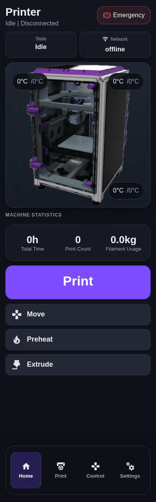
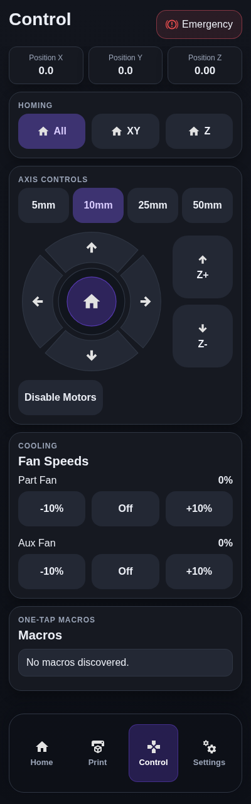

> **Superseded prototype:** the active implementation is native C++/LVGL HelixScreen at [alextverdyy/helixscreen-k3](https://github.com/alextverdyy/helixscreen-k3). This React kiosk is a visual reference only; the user requires a native touchscreen application.

# K3 Touchscreen — reference edition

Based on [tdunl410/printer-ui-klipper](https://github.com/tdunl410/printer-ui-klipper), following the original K3 portrait screenshots. This is the React/Moonraker kiosk interface, separate from the earlier native HelixScreen experiment.

The home screen keeps the K3 render, temperature chips, large Print button and quick actions. Control keeps the circular XY jog pad, homing, Z movement, fans and macros. Four labeled navigation tabs remain visible. The header and navigation reserve their own space, so controls scroll between them without being covered.

Settings → Screen appearance adds a custom accent, 100/110/120% text size, reset, and JSON import/export. The four existing themes remain. Appearance is stored in this browser; exports contain no Moonraker addresses or credentials. Firmware and printer commands use the original Moonraker transport.




## Run locally

Use Node.js 20.19+ or 22.12+:

```sh
npm ci
npm run dev -- --host 127.0.0.1
```

For a production build: `npm run build`, then `npm run start:kiosk-server`. Connect to Moonraker from Settings → Connectivity. Offline screens show zero readings; these are not live telemetry.

## Install on the printer host

```sh
git clone https://github.com/alextverdyy/printer-ui-k3.git
cd printer-ui-k3
./scripts/install-printer-ui.sh
```

The inherited installer configures the static server and Chromium kiosk services; it requires sudo on your printer host. Set the Waveshare display to portrait in the host's display configuration. Native 400×1280 is the primary target; shorter portrait displays scroll. Exact HDMI/DSI boot settings depend on the panel model.

Browser checks cover 400×1280 and 480×800, navigation, text scaling, local appearance persistence, import/export validation, and emergency confirmation. Production build and unit tests pass. A physical Waveshare screen and a live Klipper printer have not been tested here.

---

## Upstream documentation

# Klipper Portrait Touch UI
Klipper ui designed for my annex k3 with a vertical waveshare 7.9" touchscreen


## Screenshots
Captured at the native `400x1280` portrait size (no printer connected, so values are empty).

| Home | Files | Preheat | Extrude |
|---|---|---|---|
|  |  |  |  |

| Control | Settings | Connectivity | Updates |
|---|---|---|---|
|  |  |  |  |

Print screen (shown while Klipper is printing or paused; this capture uses sample data):


## Repository Layout
- `src/transport` Moonraker HTTP and WebSocket clients
- `src/services` command methods wrapping mutating actions
- `src/stores` Zustand live state/store
- `src/screens` routed UI screens
- `src/components` shared frame/layout and feedback UI
- `server/static-server.mjs` production static file server for kiosk deployment
- `scripts/install-printer-ui.sh` install/build/systemd setup
- `scripts/update-printer-ui.sh` update path after `git pull`

## Local Development
```bash
npm install
npm run dev
```

## Build
```bash
npm run build
npm run preview
```

## Full Printer Installation (Clone-and-Install)
Run on your printer host user (non-root, must have `sudo`):

```bash
git clone https://github.com/tdunl410/printer-ui-klipper.git printer_ui
cd printer_ui
chmod +x scripts/install-printer-ui.sh scripts/update-printer-ui.sh
./scripts/install-printer-ui.sh
```

The installer now auto-installs/upgrades Node.js 20+ on Raspberry Pi OS/Debian (apt-based) when needed.
Default method uses official Node.js 20 binary install first (avoids apt mirror/package drift issues), then falls back to apt.

Recommended on Raspberry Pi:
```bash
INSTALL_NODE_METHOD=binary ./scripts/install-printer-ui.sh
```

This installs:
- `/opt/printer-ui/dist` static frontend files
- `/opt/printer-ui/server/static-server.mjs` runtime server
- `/etc/default/printer-ui` server runtime environment
- `printer-ui.service` systemd service (enabled + started)
- `printer-ui-kiosk.service` systemd template for Chromium kiosk

Service URLs:
- Default host/port: `127.0.0.1:4409`
- Configure via env vars before install: `PRINTER_UI_HOST`, `PRINTER_UI_PORT`

If you want to disable automatic Node installation:
```bash
AUTO_INSTALL_NODE=0 ./scripts/install-printer-ui.sh
```

Force apt-based Node installation (if you prefer package manager flow):
```bash
INSTALL_NODE_METHOD=apt ./scripts/install-printer-ui.sh
```

Manual Node fallback (if your image blocks auto-install):
```bash
curl -fsSL https://deb.nodesource.com/setup_20.x | sudo -E bash -
sudo apt-get install -y nodejs
```

Enable kiosk mode:
```bash
sudo systemctl enable --now printer-ui-kiosk.service
```

If kiosk restarts or the panel blinks/clears, check:
```bash
systemctl status printer-ui-kiosk.service --no-pager
journalctl -u printer-ui-kiosk.service -n 120 --no-pager
tail -n 120 /tmp/printer-ui-kiosk.log
```

## Update After Changes
```bash
cd ~/printer_ui/printer-ui-klipper
./scripts/update-printer-ui.sh
sudo systemctl restart printer-ui.service
sudo systemctl restart printer-ui-kiosk.service
```

### Update button source path
The in-app **Update Screen** action runs `scripts/update-printer-ui.sh` from the path set in `/etc/default/printer-ui`.

Ensure this points to your real git clone (not `/opt/printer-ui`):

```bash
sudo sed -i 's|^PRINTER_UI_SOURCE_DIR=.*|PRINTER_UI_SOURCE_DIR=/home/pi/printer_ui|' /etc/default/printer-ui
sudo sed -i 's|^PRINTER_UI_UPDATE_SCRIPT=.*|PRINTER_UI_UPDATE_SCRIPT=/home/pi/printer_ui/scripts/update-printer-ui.sh|' /etc/default/printer-ui
sudo systemctl restart printer-ui.service
```

If those keys are missing, re-run `./scripts/install-printer-ui.sh` from your cloned repo once.

### Lockfile note (`npm ci`)
- Do not delete `package-lock.json`.
- If `npm ci` reports lockfile drift, run:

```bash
npm install
git add package-lock.json
git commit -m "chore: refresh lockfile"
git push
```

The update script now auto-falls back to `npm install` when `npm ci` fails or `package-lock.json` is missing.


## Disabling klipperscreen
```
sudo systemctl disable --now KlipperScreen.service
```


## Does chromium not want to install???


Run these commands exactly on the Pi (copy/paste block by block):
```
sudo rm -f /etc/apt/preferences.d/99-block-bullseye-security
sudo tee /etc/apt/preferences.d/99-block-bullseye-security >/dev/null <<'EOF'
Package: *
Pin: release n=bullseye-security
Pin-Priority: -1
EOF
```
```sudo apt-get clean
sudo rm -rf /var/lib/apt/lists/*
sudo apt-get -o Acquire::ForceIPv4=true -o Acquire::Retries=5 update
```
Then install kiosk deps again:
```
sudo apt-get -o Acquire::ForceIPv4=true -o Acquire::Retries=5 install -y --no-install-recommends xinit xserver-xorg chromium-browser
```
If that still fails, use Debian chromium path:
```
sudo apt-get -o Acquire::ForceIPv4=true -o Acquire::Retries=5 install -y --no-install-recommends xinit xserver-xorg chromium chromium-sandbox
```

Then finish:
```
INSTALL_NODE_METHOD=binary ./scripts/install-printer-ui.sh
sudo systemctl restart printer-ui-kiosk.service
systemctl status printer-ui-kiosk.service --no-pager
```

After it works, re-enable security repo priority by removing the temp pin:
```sudo rm -f /etc/apt/preferences.d/99-block-bullseye-security
sudo apt-get update
```